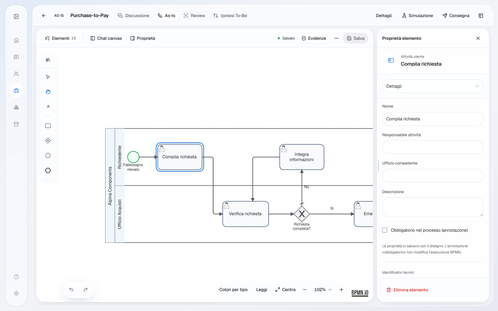
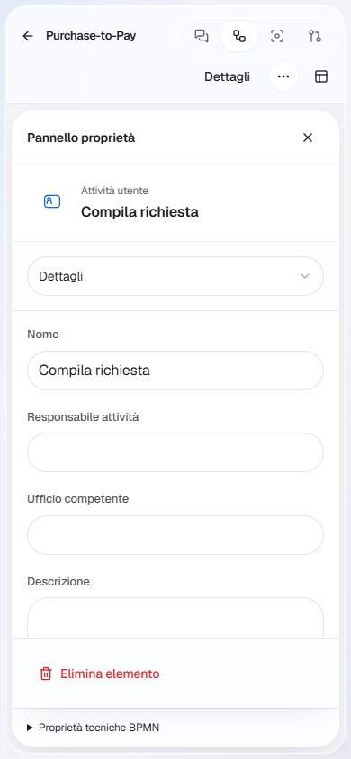

# DeliR — canvas BPMN: UI e UX

Data: 3 novembre 2026. Branch: codex/bpmn-canvas-ui.

## Vincolo XML

L'XML BPMN rimane la fonte del modello. Nessuna modifica a schema, moddle, generazione, importazione, esportazione, API, versionamento, bozze o controlli di conflitto. Nessuna nuova dipendenza. Le modifiche al contenuto fatte dall'utente continuano a passare dai comandi del modeler e dal salvataggio esistenti.

Il diff di useBpmnCanvas.ts aggiunge solo il collegamento al nuovo adattatore UI. useBpmnCanvasUi.ts osserva selezione, zoom, strumenti e command stack; inoltra selezione dello strumento, azioni contestuali, undo/redo e zoom ai servizi già presenti. Non converte né serializza XML. La UI non ricrea regole BPMN: mostra esclusivamente le azioni offerte dal provider per la selezione corrente.

## Esperienza

- Barra dei comandi integrata nel workspace, distinta dagli strumenti di modifica.
- Strumenti condivisi da 44 px, icone SVG, stati attivi e libreria con ricerca e categorie.
- Azioni della selezione raggruppate: aggiunta, collegamento, cambio tipo, altre azioni. Il context pad nativo viene sostituito visivamente; i suoi handler restano quelli originali.
- Annulla/ripeti visibili e zoom percentuale con preset. Pan e zoom usano i servizi di viewport esistenti, con una policy mouse/trackpad esplicita; collegamenti e posizionamento restano comandi nativi.
- Proprietà con gerarchia leggibile, un selettore di sezioni e dettagli tecnici separati. Campi, annotazioni e handler rimangono quelli esistenti.
- Desktop: ispettore laterale ridimensionabile. Schermi compatti: selezione sul canvas, proprietà aperte esplicitamente a pieno spazio, ritorno del focus alla chiusura.
- Materiali, focus, colori e controlli condividono i token DeliR. I colori DI espliciti importati mantengono precedenza. Il marchio richiesto da bpmn.io rimane presente.

## Riferimenti

La struttura dell'editor deriva dall'analisi di Figma/FigJam; navigazione e distinzione tra creazione e viewport da Miro; gerarchia da Linear. Lucid è il riferimento per la leggibilità di pool e lane. Canva informa la direzione futura dei contenuti, che non viene implementata in questa PR.

Fonti, identificativi REA e limiti delle osservazioni sono nel [benchmark](canvas-enterprise-benchmark-2026-11-03.md) e nel relativo manifest. Queste attribuzioni descrivono scelte progettuali: non dichiarano equivalenza completa con gli editor Enterprise autenticati.

## Verifica

Le prove E2E usano dati sintetici e API intercettate. Coprono libreria, creazione, selezione, proprietà, importazione, salvataggio e riapertura, conservazione di ID/collegamenti/annotazioni, recupero dagli errori, undo/redo, colori ed accessibilità axe. La navigazione e lo zoom non devono produrre scritture XML.

Le catture REA usano un frontend separato su loopback e una fixture sintetica. Non sono salvati contenuti di board private. Le schermate dimostrano gli stati catturati; le verifiche di persistenza provengono dai test di round trip.

La suite completa precedente ha problemi E2E noti dopo il merge di #161; i controlli mirati di questa PR non equivalgono a una certificazione dell'intera matrice CI.

## Mouse: problemi riprodotti e correzioni

Il probe iniziale ha riprodotto: secondo clic che deseleziona il nodo; stato della mano che torna a selezione dopo il drag; V senza effetto; trascinamento del vuoto che muove la camera mentre il controllo indica selezione; scorciatoie inattive dopo l'uso della toolbar. Il confronto comprende stati del viewport, coordinate dei nodi, selezione, strumento e richieste PUT.

La policy ora distingue:
- V: selezione stabile e riquadro di selezione sul vuoto.
- H: mano persistente, con cursore grab/grabbing.
- Spazio + trascinamento: pan temporaneo; al rilascio torna lo strumento precedente.
- Tasto centrale o destro + trascinamento: pan senza spostare i nodi.
- Mouse: rotella per zoom ancorato al puntatore. Trackpad: scorrimento per pan; Ctrl/Cmd + rotella o pinch per zoom. La preferenza è nel menu del canvas e si conserva nel browser.
- Le gesture non intercettano la digitazione nei campi o le interazioni nei menu. I movimenti di viewport sono accorpati per frame; la cattura del puntatore mantiene il drag anche oltre i bordi della tela.

Fonti UX: [Miro: mouse, trackpad e touchscreen](https://help.miro.com/hc/en-us/articles/360017731053-Using-Miro-with-a-mouse-trackpad-or-touchscreen), [Figma: navigare il canvas](https://help.figma.com/hc/en-us/articles/30925881896727-FD4B-Navigate-Figma-Design-files). Sono convenzioni applicate a DeliR, non una dichiarazione di equivalenza integrale con quei prodotti.

È emerso anche un difetto di undo preesistente: il ridisegno dei collegamenti veniva rinviato al frame seguente e aggiungeva comandi separati dopo lo spostamento. La stessa operazione viene ora eseguita dentro il gruppo del comando di movimento/ridimensionamento. Un solo Annulla ripristina il gesto. Non cambia il formato XML o il percorso di salvataggio.

REA osserva il browser sintetico tramite CDP e conserva screenshot e stato runtime. Le traiettorie del mouse sono eseguite dal driver Playwright e confrontate prima/dopo; i test E2E aggiungono asserzioni di integrità. Il process capture PTY REA non è disponibile su Windows; l'ispezione completa dei listener ha superato il budget di metadati del bundle Vite. Questi tentativi non vengono presentati come prove riuscite. Nessuna navigazione o modifica sul modello reale aperto dall'utente.

### Esito locale

- 18 scenari E2E Chromium desktop/mobile passati, con axe nei percorsi di proprietà, selezione e gerarchia.
- TypeScript, ESLint sui file interessati e build produzione passati.
- 35 test unitari mirati passati in esecuzioni separate: XML, annotazioni/provenance, bozze, versioni, viewport e toolbar. I tentativi con timeout di avvio del worker sono stati rieseguiti e non vengono contati come superati.
- [Manifest delle evidenze e replay](canvas-ui-evidence-2026-11-03.json).

