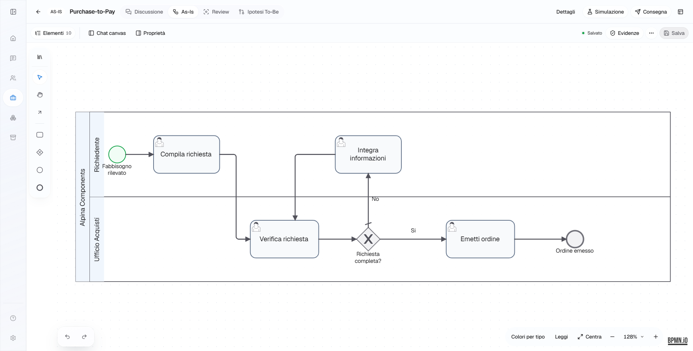
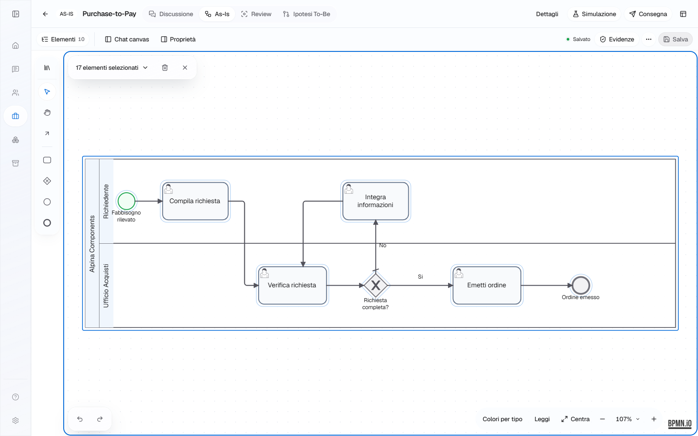
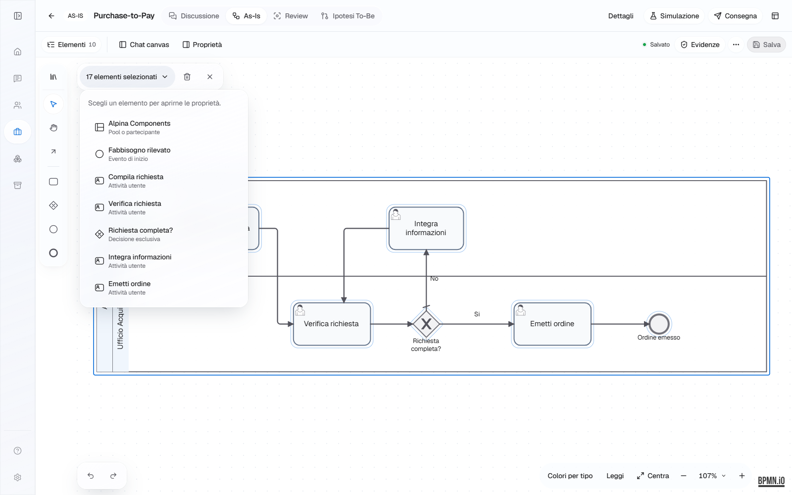
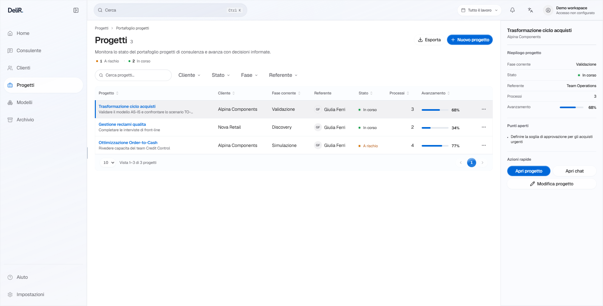

# DeliR: superfici continue e selezione sul canvas

Data: 4 novembre 2026. Integrazione alla PR #165.

## Risultato

La shell non somma più margine esterno, cornice della pagina e cornici dei pannelli. Sidebar, chat, canvas, review e simulazione occupano tracce contigue. I token condivisi distinguono la superficie strutturale (workspace, senza raggio esterno) dalle card di contenuto (12 px) e dai controlli flottanti. Il contenuto mantiene gutter leggibili e controlli da 44 px.

Il bordo minimo richiesto rimane come ombreggiatura interna sfumata: material-soft-edge e material-soft-separator. Non introduce spazio tra i pannelli. I separatori hanno contrasto molto contenuto; indicatori di focus e selezione restano distinguibili. Le componenti condivise Surface, PanelShell, WorkspaceInspector, WorkspaceListView e CanvasWorkspace applicano le regole, senza patch per singola route.

Il colore semantico canvas-grid-color passa dal 55% al 72% del bordo sottile: incremento leggero della visibilità dei punti. Editor, review e simulazione usano lo stesso token.

## Selezione multipla

- Nessun ispettore automatico vuoto: il diagramma conserva la larghezza disponibile.
- Il conteggio apre un elenco navigabile; scegliere una riga seleziona l'elemento e ne apre le proprietà esistenti.
- Le etichette grafiche vengono ricondotte al proprietario e deduplicate. Nella fixture, 22 grafiche selezionate corrispondono a 17 oggetti BPMN distinti, inclusi i collegamenti.
- Eliminazione disponibile direttamente solo quando offerta dal provider nativo; deselezione esplicita con ritorno del focus al canvas.
- Confine del gruppo chiaro, contorni dei nodi sottili, niente cornici aggiuntive intorno a etichette, collegamenti, pool e lane durante la selezione multipla.
- Il pannello Proprietà aperto esplicitamente mostra lo stesso elenco, invece di uno stato vuoto.

I nuovi marker sono classi di presentazione del registry. Il motore, i target della selezione nativa, i comandi di eliminazione/annullamento e l'XML non sono sostituiti.

## Riferimenti e REA

Le convenzioni derivano dal [benchmark già acquisito](canvas-enterprise-benchmark-2026-11-03.md): [Miro, mouse/trackpad](https://help.miro.com/hc/en-us/articles/360017731053-Using-Miro-with-a-mouse-trackpad-or-touchscreen), [Figma, canvas](https://help.figma.com/hc/en-us/articles/30925881896727-FD4B-Navigate-Figma-Design-files) e [Linear, gerarchia](https://linear.app/changelog/2026-03-12-ui-refresh). Il bordo morbido segue la preferenza esplicita dell'utente per ChatGPT; non dichiariamo una misura CSS ricavata dal prodotto.

REA ha osservato passivamente il frontend sintetico e acquisito le catture:
- canvas: ev_625e17f9e30ccfd3d7573704c640985e3061c9022832ef84ec4ff8a045a8f07d;
- selezione: ev_37a73ad269fe6874b39d045d0874c12e4c14b9523d6429614c58a473c80f26c9;
- ispezione runtime: ev_d872dca18a445fb1800c35b8795864e0733d2c0a555a130a651ece26030e7da8.

Le due catture hanno copertura completa della finestra acquisita. L'ispezione runtime è policy_filtered/attach_limited: non equivale a una registrazione completa del traffico o della cronologia console. Le gesture sono eseguite da Playwright; REA osserva gli stati risultanti. Receipt, digest PNG e limiti sono in [proofs](proofs/continuous-canvas-2026-11-04/).

## Verifica

16 stati visivi: Home, Clienti, Progetti, Consulente, Canvas, Review, Simulazione e Impostazioni su 1882×956 e 390×844. Nessun overflow orizzontale, nessun pageerror e nessuna violazione axe nel main delle schermate controllate.

8 E2E Chromium passati in due esecuzioni: proprietà e salvataggio/riapertura desktop/mobile, navigazione mobile, camera e resize a 1440/1920, separazione pan/selezione/movimento, marquee con eliminazione/undo, elenco con scelta singola e focus dopo deselezione. 15 test unitari mirati passati, TypeScript/ESLint e build produzione passati. I tentativi con hot reload e con worker non avviato non vengono contati come riusciti; dettagli nel [manifest](continuous-canvas-evidence-2026-11-04.json).

La build segnala ancora chunk oltre 500 kB. La matrice CI completa e Safari/WebKit non sono certificati da questa verifica. Nel precedente head i job Playwright CI erano cancellati; il gate complessivo non era verde.

## Anteprime sintetiche

