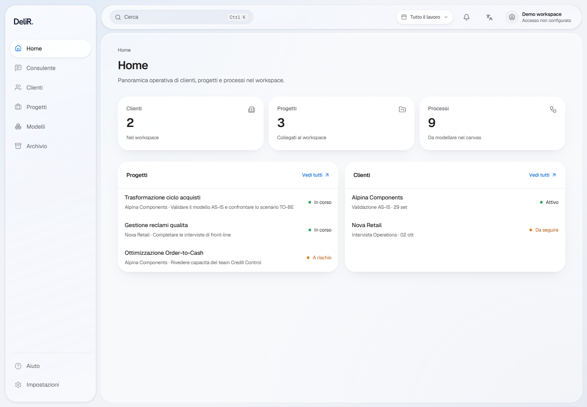
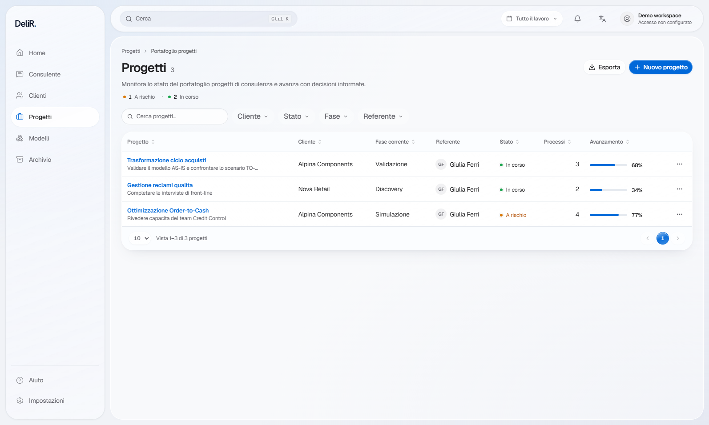

# DeliR — Liquid Glass design system, 31 ottobre 2026

Sohay ha richiesto un redesign del prodotto con finitura ispirata ad Apple,
includendo componenti, colori, contrasti, microinterazioni e navigazione del
canvas. Apple, ChatGPT e Miro sono i riferimenti principali; n8n, Notion e
Linear integrano lo studio dei flussi operativi. Questa PR applica la direzione
ai componenti e ai token condivisi, alla shell, alle liste, alla chat e al canvas BPMN.
Il 31 ottobre Sohay ha confermato esplicitamente **Liquid Glass e capsule morbide**,
chiedendo coerenza nell'intero prodotto attraverso il design system.
L'approvazione estetica finale resta alla revisione della PR.

## Cosa è stato osservato

Le osservazioni pubbliche usano REA 6.7.0 via CLI, Chrome con profili temporanei,
viewport 1440×1000 e 390×844, lingua italiana e movimento ridotto. Input,
Evidence complete e screenshot originali restano nella directory locale ignorata
`artifacts/rea-uiux-2026-10-27/`; non vengono pubblicati contenuti degli account.

| Riferimento | Evidenza e limite | Applicazione a DeliR |
| --- | --- | --- |
| [Apple](https://www.apple.com/) | REA desktop/mobile e apertura menu mobile; sito pubblico, non app macOS | Neutri, gerarchia, controlli discreti, azione primaria riconoscibile |
| [ChatGPT](https://chatgpt.com/) | Il profilo REA isolato incontra Cloudflare; screenshot ufficiale Projects acquisito con REA. Successivamente osservata la scheda aperta dall'utente con CUA, inclusa rigenerazione e transizione elaborazione → Interrompi → risposta completata | Composer unico, invio/stop nella stessa posizione, risposta come prosa e controlli secondari contestuali |
| [Miro](https://miro.com/) | REA sul sito pubblico; successivamente canvas reale aperto dall'utente osservato con CUA, menu zoom aperto e richiuso. Nessun documento esportato | Separare documento, creazione e navigazione; comandi ai bordi; fit esplicito; pannelli temporanei |
| [n8n](https://docs.n8n.io/build/keyboard-shortcuts.md) | Documentazione e immagini ufficiali, senza istanza autenticata né esecuzioni | Distinguere pan, zoom, fit, selezione e configurazione del nodo |
| [Notion](https://www.notion.com/help/navigate-with-the-sidebar) | REA sul sito pubblico e documentazione ufficiale | Shell stabile, ricerca con ambito chiaro, dettagli che conservano il contesto |
| [Linear](https://linear.app/docs/search) | REA sul sito pubblico con anteprima prodotto e documentazione | Densità leggibile, ricerca globale distinta dai filtri della vista |

Le osservazioni CUA non sono Evidence REA. Non sono state misurate le durate
delle animazioni o i rapporti di contrasto dei brand esterni. I valori seguenti
sono scelte e misurazioni di DeliR.

Evidence principali: Apple desktop `ev_f28406ff7f418ed206b26dcb816df1d9d7560f0117905bf0bbdffc6b05bd1977`;
menu mobile `ev_d2d17d87691933a831d8f190f6116f5add3dcc43a67d410c3e58e27834aea7d9`;
Miro pubblico `ev_35bd146671f0cb7d64185c97f3cbd720c4875b4db936349b2288d2f41f15af17`;
ChatGPT screenshot ufficiale `ev_0191a66b59cdf085ea77b269159ff7762eb5079b6436a78e595bfce657abb7ee`.
Gli identificativi si riferiscono ai JSON locali conservati, non a un servizio remoto.

## Materiali e componenti condivisi

- Ambiente chiaro con luce fredda discreta, pannelli bianchi quasi opachi,
  chrome traslucido; Geist e marchio DeliR conservati.
- Navigazione flottante, capsule, riflessi chiari e ombre a più livelli.
  Vetro regolare su controlli e sovrapposizioni; contenuto stabile e leggibile.
- Raggio dei pannelli 26 px, composer 30 px, sovrapposizioni 24 px; pulsanti e
  selezione a capsula. Gli alias legacy puntano agli stessi token, anche in
  review, simulazione, consegna e impostazioni.
- Tipografia operativa più leggibile; titoli di sezione in forma normale.
  Le righe collegano progetto e prossimo passo già presente nei dati.
- Controlli coerenti: riposo, hover, pressione, apertura, selezione, focus e
  disabilitato. Transizioni di colore/ombra di 150 ms senza spostare la geometria.
- Focus esplicito, reduced-motion, reduced-transparency e forced-colors.
  La lingua selezionata ha anche un check; gli stati mantengono testo e simboli.
- Shell con target da 44 px; composer con invio/stop circolare e stabile.
  Nel pannello stretto preferenze e comandi hanno due righe deliberate;
  autonomia, allegati e registrazione restano disponibili.
- Canvas mobile con accesso compatto alla libreria degli elementi e comandi
  Leggi/Centra visibili. Il fit iniziale resta distinto dal comando di lettura.
  I colori BPMN importati esplicitamente non vengono riscritti.
- Rotella normalizzata per pixel, righe e pagine; Shift per pan orizzontale;
  Ctrl/Cmd per zoom al puntatore. Pulsanti BPMN e input nativi condividono il
  limite del 400%. Aprire pannelli o ridimensionare non richiede un nuovo fit.
- Riprova della Home ricarica anche i clienti quando quella richiesta fallisce.

## Evidenze REA aggiornate e riferimenti

REA MCP ha ispezionato direttamente il riferimento ufficiale Apple:

- [Presentazione Liquid Glass](https://www.apple.com/uk/newsroom/2025/06/apple-introduces-a-delightful-and-elegant-new-software-design/):
  `ev_a6f8da3b1d660b10cf3e7937faf31f61434e7cb1ba05fec79e8ce51497e55274`.
- [Materiali Apple HIG](https://developer.apple.com/design/human-interface-guidelines/materials),
  scorrimento alla sezione Liquid Glass:
  `ev_5fae7083a621fd0faa3becc7e99dd270fc738ea24fc17f2b39c76a55b49650dd`.

Entrambe complete, esportate in `liquid-glass-2026-10-31.bundle.json` nella
directory locale delle evidenze. Il rendering web ricostruisce il linguaggio
visivo con CSS; non è lo shader nativo di macOS e non se ne dichiara identità pixel per pixel.

Verifica renderizzata iniziale: 9 controlli desktop/mobile su Home, progetti,
chat e canvas superati (assenza di errori JavaScript e overflow del documento,
nessuna violazione axe seria/critica; focus tastiera e libreria mobile).
61 test mirati superati in 11 file. Non è una certificazione WCAG completa.

Verifica estesa: 18 superfici per 2 viewport, senza errori JavaScript, fallimenti
HTTP o overflow del documento; 20 scansioni axe aggiuntive senza violazioni.
Il percorso da cliente a progetto, chat, canvas, review, simulazione e consegna
è stato percorso tramite i comandi reali dell'interfaccia, senza mutazioni.

## Anteprime del design system applicato

La tabella condivisa usa intestazioni in forma normale e padding compatto:
la colonna finale resta interamente visibile a 1440 px nonostante il nuovo
inset della shell. Su mobile conserva lo scorrimento orizzontale accessibile.

### Spazio e feedback dei controlli

Il pannello laterale delle liste richiede almeno **112rem**: il budget include
sidebar, margini, tabella leggibile e ispettore da 320px. La media query usata
dai clic delle righe corrisponde al breakpoint CSS. A 1594px la lista usa la
larghezza disponibile; alle larghezze maggiori può affiancare il dettaglio.
Le tabelle brevi seguono il contenuto, mentre quelle lunghe si riducono nello
spazio disponibile mantenendo lo scorrimento interno.

I filtri sono controlli secondari leggeri, distinti dalle azioni a pulsante.
La pressione dei pulsanti usa una variazione ottica del 2% senza cambiare il
flusso del layout; il menu entra in 180ms ed esce in 100ms. La preferenza di
movimento ridotto disabilita questi effetti. La ricostruzione REA a 1594×956
è completa: `ev_d2375138ba4c72253e144269e709e8238414f1d028beceb0c2ad8d9895fc9f0d`.

| Area | Anteprima |
| --- | --- |
| Progetto | [Desktop](previews/liquid-project-detail-desktop.png) |
| Chat | [Mobile](previews/liquid-chat-mobile.png) |
| Canvas | [Desktop](previews/liquid-canvas-desktop.png) |
| Review | [Desktop](previews/liquid-review-desktop.png) |
| Simulazione | [Desktop](previews/liquid-simulation-desktop.png) |
| Consegna | [Mobile](previews/liquid-handover-mobile.png) |

Le scelte seguono [Apple HIG: materiali](https://developer.apple.com/design/human-interface-guidelines/materials),
[colore](https://developer.apple.com/design/human-interface-guidelines/color),
[feedback](https://developer.apple.com/design/human-interface-guidelines/feedback)
e [movimento](https://developer.apple.com/design/human-interface-guidelines/motion).
La disposizione del canvas è confrontata con [Miro Toolbars](https://help.miro.com/hc/en-us/articles/360017730553-Toolbars).
I materiali spiegano i livelli; il colore ha significato coerente; il feedback
comunica stato e recupero; il movimento sostiene l'orientamento.

## Anteprime e limiti

Le anteprime collegate nella PR usano esclusivamente i dati dimostrativi sintetici
della fixture pitch esistente, su API locale separata dal backend. Nessuna
istantanea contiene dati cliente reali. Sono esempi del prodotto implementato,
non mockup sostitutivi del frontend.

La simulazione mantiene due camere: tela analitica e processo incorporato.
Il pinch del trackpad passa attraverso Ctrl+wheel; il pinch touchscreen a due
dita nel canvas analitico personalizzato resta da implementare. Le verifiche
desktop/mobile non equivalgono a un test su un dispositivo touch fisico.
La PR non certifica autenticazione enterprise, permessi o conformità completa.

La raccolta precedente `DESIGN.md` e l'audit del 20 ottobre sono materiale
storico locale: non descrivono automaticamente lo stato attuale. Il design
system aggiornato è [satin-design-system.md](satin-design-system.md).

## Correzioni sul feedback — 1 novembre 2026

Le correzioni passano dai componenti condivisi. Input, Textarea e Select usano
un solo bordo di focus da 1px, con aura al 10% e senza contorno separato.
Il contrasto del bordo resta distinguibile; in forced colors si usa il contorno
nativo Highlight. Hover, stato disabilitato e stato di errore restano separati.

La variante navigation di Tabs viene usata dal processo e dal piano BPMN.
Mantiene selezione, frecce da tastiera e focus in un'unica composizione.
ActionPrompt raccoglie versione, domanda effettiva, azione e chiusura: sostituisce
la striscia a larghezza piena sopra il composer.

DialogContent offre ora una variante sheet con gli stessi materiali di Surface,
animazione e fallback per movimento ridotto. DialogActions mantiene leggibili le
etichette e impila le azioni su mobile. Il focus torna al comando di apertura
anche nei form che usano autofocus. La review riusa Tabs, Surface, Input,
Textarea, Button e InlineNotice, eliminando le ricette CSS concorrenti del pannello.

Decidi apre direttamente le decisioni senza inviare risposte o generare modelli.
Sintesi e struttura restano accessibili dai tab. La vista di lettura presenta il
piano del processo, senza nomi di file o etichette di formato; Markdown compare
nel solo editor dove serve a capire cosa si sta modificando. Sul canvas review
è rimossa l'identità duplicata; l'attribuzione BPMN.io resta presente.

Verifica del follow-up: typecheck, lint e build riusciti; 24 test in 3 suite
esistenti; 4 scenari browser riusciti. Layout controllato a 1594, 1792, 1920 e
390px, tabelle sintetiche da 3 e 15 righe, movimento normale e ridotto.
Dieci scansioni axe a 1594/390px senza violazioni rilevate. Verificati navigazione
con frecce, editor, risposta libera senza invio, Escape, ritorno del focus e
assenza di testo tagliato nelle azioni del pannello.

Le sei catture REA sono complete e senza page errors. Identità, digest delle
immagini, passi e risultati sono nel [manifest di verifica](previews/feedback-verification-2026-11-01.json).
Sono verifiche su fixture sintetica, non una certificazione dell'intero prodotto.

| Superficie | Anteprima implementata |
| --- | --- |
| Campo selezionato | [Desktop](previews/liquid-field-focus-desktop.png) |
| Chat e prossima decisione | [Desktop](previews/liquid-process-chat-desktop.png) |
| Piano e sintesi | [Desktop](previews/liquid-plan-summary-desktop.png) |
| Decisioni | [Desktop](previews/liquid-plan-decisions-desktop.png) · [Mobile](previews/liquid-plan-decisions-mobile.png) |
| Portafoglio progetti | [Desktop 1594px](previews/liquid-projects-desktop.png) |

## Gerarchia degli spazi e sidebar regolabile — 1 novembre 2026

La shell usa un budget unico: margini e separazioni da 16px, navigazione iniziale
272px, barra globale da 72px e intestazione contestuale condivisa da 64px.
Sui telefoni restano inset e comandi adattati al viewport. La cronologia della
chat è un livello secondario; la conversazione usa la superficie principale,
lo stesso WorkspaceContextBar degli altri workspace e testo da 16px.

La sidebar principale si ridimensiona trascinando il bordo destro, tra 224 e
384px. Il comando nell'intestazione la comprime a 72px e ripristina l'ultima larghezza.
Il separatore supporta frecce, Home ed End. Stato e larghezza restano nel browser
tra navigazioni e ricaricamenti; storage assente o malformato non blocca l'uso.
La griglia della shell si aggiorna insieme alla sidebar: i pannelli non si
sovrappongono al contenuto. Il separatore è lo stesso componente degli ispettori.

Negli studio BPMN e simulazione la barra globale separata viene sostituita da
Strumenti workspace nell'header contestuale. Ricerca, avvisi, lingua, account e
navigazione mobile restano disponibili; Ctrl/Cmd+K continua a funzionare.
Il comando globale resta raggiungibile anche durante caricamento o errore della
schermata. Il processo e le sue viste sono raggruppati a sinistra del contesto.

La simulazione distingue la vista di osservazione dall'analisi: il selettore
condiviso SegmentedControl cambia il modo di vedere lo stesso canvas, mentre
Analisi apre gli strumenti secondari. Il pannello risultati parte da 320px,
è ridimensionabile e può essere chiuso con Mostra solo il canvas. I pannelli di
confronto partono da 400px. Non vengono alterati scenari o risultati del backend.
Il focus entra nel pannello scelto e torna al comando di apertura alla chiusura.

A 1882×956 il canvas BPMN misura 771px in altezza; la zona analitica della
simulazione misura 730px. Sono misure delle fixture controllate, non promesse per
ogni contenuto. A 1440px resta la stessa altezza; su viewport stretti i pannelli
si dispongono in sequenza con scorrimento interno. Non è un comportamento di
sovrapposizione obbligatoria del pannello sul canvas.

Verifica: build, lint e typecheck riusciti; 15 test in cinque suite, inclusi
quattro test della preferenza di navigazione. Sei scenari browser per gerarchia,
resize, persistenza e recupero più due regressioni su tabelle/movimento riusciti.
Le tre superfici sono controllate a 1882, 1440, 1024 e 390px; sei scansioni axe
senza violazioni rilevate. Catture REA complete e senza page errors.

Il [manifest di questa verifica](previews/hierarchy-verification-2026-11-01.json)
conserva misure, passi ed Evidence. Tutte le anteprime usano dati sintetici.

| Superficie | Anteprima |
| --- | --- |
| Consulente, sidebar estesa a 384px | [Desktop](previews/hierarchy-consultant-wide.png) |
| Consulente, sidebar compatta | [Desktop](previews/hierarchy-consultant-compact.png) |
| Canvas BPMN, header unificato | [Desktop](previews/hierarchy-canvas.png) · [Mobile](previews/hierarchy-canvas-mobile.png) |
| Simulazione con analisi aperta | [Desktop](previews/hierarchy-simulation.png) |
| Simulazione senza pannello laterale | [Desktop](previews/hierarchy-simulation-canvas.png) |

## Editor scenario leggibile — 1 novembre 2026

Il configuratore distingue la modifica dall'ispezione dei risultati. WorkspaceInspector
offre una variante edit: apertura a 600px, ridimensionamento fino a 760px quando
lo spazio del canvas lo consente e intestazione da almeno 88px. EditorWorkspace,
EditorBody ed EditorActions definiscono una composizione riutilizzabile: navigazione
persistente, un solo corpo scorrevole e azioni sempre raggiungibili. DetailPanelSection
espone ancore stabili per raggiungere i gruppi di parametri.

La navigazione per sezione sostituisce la fila di comandi che andava a capo e
segue anche lo scorrimento manuale, consentendo di tornare alla stessa sezione.
Il menu Strumenti raccoglie modifica in linguaggio naturale, ipotesi e risultati.
La modifica testuale si apre su richiesta; conferme e guardie prima dell'applicazione
restano attive. Titoli duplicati e contenitori con scroll annidati sono rimossi.
Campi da almeno 44px, spaziatura dei gruppi e colonne sensibili alla larghezza
dell'editor usano le primitive e i materiali condivisi.

Sotto 1200px, il configuratore occupa lo spazio di lavoro e la chiusura restituisce
il canvas. Il trascinamento dell'ispettore resta un'interazione desktop. L'avviso
di bozza locale rimane visibile come stato con dettagli espandibili: la mancata
disponibilità dell'API degli scenari nella fixture non viene presentata come risolta.

Le anteprime usano dati sintetici. Il manifest dedicato conserva misure, risultati
e identificativi REA: [verifica editor scenario](previews/scenario-editor-verification-2026-11-01.json).

| Superficie | Anteprima |
| --- | --- |
| Configuratore e canvas | [Desktop 1882px](previews/scenario-editor-desktop.png) |
| Parametri delle risorse | [Desktop](previews/scenario-editor-resources.png) |
| Editor compatto | [Mobile](previews/scenario-editor-mobile.png) |

Verifica del configuratore: typecheck, lint e build riusciti; 10 test in due
suite esistenti e quattro scenari browser a 1882, 1440, 1024 e 390px. Quattro
scansioni axe senza violazioni rilevate. Verificati scorrimento unico, selezione
ripetuta delle sezioni, ritorno del focus dal dialogo, resize da tastiera
480–760px e ripristino del canvas su tablet/mobile. Le tre catture REA sono
complete, senza page errors e con chiusura confermata del browser di verifica.
Restano i warning preesistenti sulla dimensione dei chunk.

## Comando della sidebar integrato — 1 novembre 2026

Il comando di espansione vive nell'intestazione di GlobalSidebar. AppLayout
passa il comportamento alla componente, senza posizionare pulsanti nel vuoto
tra navigazione e contenuto. Il controllo usa ui-chrome-control: area da 44px,
hover discreto, focus visibile e posizione statica. Nel rail compatto sostituisce
il monogramma; nella navigazione estesa si affianca al marchio. Lo spazio
dell'intestazione e l'allineamento delle voci restano stabili.

Il comando appare nei viewport desktop, dove la sidebar può espandersi; sul
rail intermedio resta il monogramma e sui telefoni resta il cassetto di navigazione.
Ridimensionamento, preferenza persistente e semantica aria-expanded restano
gestiti dai componenti esistenti.

Verifica: typecheck, lint e build riusciti; quattro scenari browser a 1882, 1440, 900
e 390px, con quattro scansioni axe senza violazioni rilevate. Controllati
contenimento del controllo da 44×44px, attivazione da tastiera, focus,
riapertura alla larghezza scelta, passaggio allo studio e cassetto mobile.
Due catture REA complete e senza page errors: [rail compatto](previews/navigation-integrated-compact.png)
e [sidebar estesa](previews/navigation-integrated-expanded.png).
Il [manifest di verifica](previews/navigation-control-verification-2026-11-01.json)
conserva misure, digest e identificativi delle prove su fixture sintetica.
