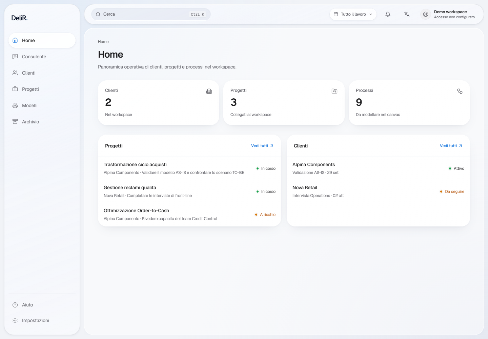
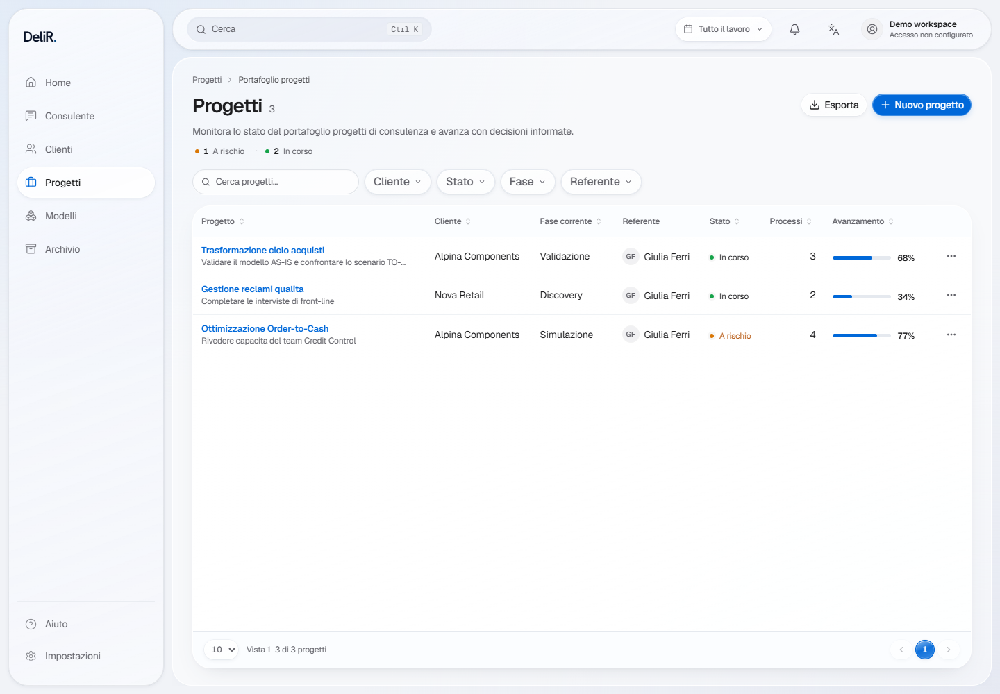

# DeliR — Liquid Glass design system, 31 ottobre 2026

Sohay ha richiesto un redesign del prodotto con finitura ispirata ad Apple,
includendo componenti, colori, contrasti, microinterazioni e navigazione del
canvas. Apple, ChatGPT e Miro sono i riferimenti principali; n8n, Notion e
Linear integrano lo studio dei flussi operativi. Questa PR applica la direzione
ai componenti e ai token condivisi, alla shell, alle liste, alla chat e al canvas BPMN.
Il 31 ottobre Sohay ha confermato esplicitamente **Liquid Glass e capsule morbide**,
chiedendo coerenza nell'intero prodotto attraverso il design system.
L'approvazione estetica finale resta alla revisione della PR.

## Cosa è stato osservato

Le osservazioni pubbliche usano REA 6.7.0 via CLI, Chrome con profili temporanei,
viewport 1440×1000 e 390×844, lingua italiana e movimento ridotto. Input,
Evidence complete e screenshot originali restano nella directory locale ignorata
`artifacts/rea-uiux-2026-10-27/`; non vengono pubblicati contenuti degli account.

| Riferimento | Evidenza e limite | Applicazione a DeliR |
| --- | --- | --- |
| [Apple](https://www.apple.com/) | REA desktop/mobile e apertura menu mobile; sito pubblico, non app macOS | Neutri, gerarchia, controlli discreti, azione primaria riconoscibile |
| [ChatGPT](https://chatgpt.com/) | Il profilo REA isolato incontra Cloudflare; screenshot ufficiale Projects acquisito con REA. Successivamente osservata la scheda aperta dall'utente con CUA, inclusa rigenerazione e transizione elaborazione → Interrompi → risposta completata | Composer unico, invio/stop nella stessa posizione, risposta come prosa e controlli secondari contestuali |
| [Miro](https://miro.com/) | REA sul sito pubblico; successivamente canvas reale aperto dall'utente osservato con CUA, menu zoom aperto e richiuso. Nessun documento esportato | Separare documento, creazione e navigazione; comandi ai bordi; fit esplicito; pannelli temporanei |
| [n8n](https://docs.n8n.io/build/keyboard-shortcuts.md) | Documentazione e immagini ufficiali, senza istanza autenticata né esecuzioni | Distinguere pan, zoom, fit, selezione e configurazione del nodo |
| [Notion](https://www.notion.com/help/navigate-with-the-sidebar) | REA sul sito pubblico e documentazione ufficiale | Shell stabile, ricerca con ambito chiaro, dettagli che conservano il contesto |
| [Linear](https://linear.app/docs/search) | REA sul sito pubblico con anteprima prodotto e documentazione | Densità leggibile, ricerca globale distinta dai filtri della vista |

Le osservazioni CUA non sono Evidence REA. Non sono state misurate le durate
delle animazioni o i rapporti di contrasto dei brand esterni. I valori seguenti
sono scelte e misurazioni di DeliR.

Evidence principali: Apple desktop `ev_f28406ff7f418ed206b26dcb816df1d9d7560f0117905bf0bbdffc6b05bd1977`;
menu mobile `ev_d2d17d87691933a831d8f190f6116f5add3dcc43a67d410c3e58e27834aea7d9`;
Miro pubblico `ev_35bd146671f0cb7d64185c97f3cbd720c4875b4db936349b2288d2f41f15af17`;
ChatGPT screenshot ufficiale `ev_0191a66b59cdf085ea77b269159ff7762eb5079b6436a78e595bfce657abb7ee`.
Gli identificativi si riferiscono ai JSON locali conservati, non a un servizio remoto.

## Materiali e componenti condivisi

- Ambiente chiaro con luce fredda discreta, pannelli bianchi quasi opachi,
  chrome traslucido; Geist e marchio DeliR conservati.
- Navigazione flottante, capsule, riflessi chiari e ombre a più livelli.
  Vetro regolare su controlli e sovrapposizioni; contenuto stabile e leggibile.
- Raggio dei pannelli 26 px, composer 30 px, sovrapposizioni 24 px; pulsanti e
  selezione a capsula. Gli alias legacy puntano agli stessi token, anche in
  review, simulazione, consegna e impostazioni.
- Tipografia operativa più leggibile; titoli di sezione in forma normale.
  Le righe collegano progetto e prossimo passo già presente nei dati.
- Controlli coerenti: riposo, hover, pressione, apertura, selezione, focus e
  disabilitato. Transizioni di colore/ombra di 150 ms senza spostare la geometria.
- Focus esplicito, reduced-motion, reduced-transparency e forced-colors.
  La lingua selezionata ha anche un check; gli stati mantengono testo e simboli.
- Shell con target da 44 px; composer con invio/stop circolare e stabile.
  Nel pannello stretto preferenze e comandi hanno due righe deliberate;
  autonomia, allegati e registrazione restano disponibili.
- Canvas mobile con accesso compatto alla libreria degli elementi e comandi
  Leggi/Centra visibili. Il fit iniziale resta distinto dal comando di lettura.
  I colori BPMN importati esplicitamente non vengono riscritti.
- Rotella normalizzata per pixel, righe e pagine; Shift per pan orizzontale;
  Ctrl/Cmd per zoom al puntatore. Pulsanti BPMN e input nativi condividono il
  limite del 400%. Aprire pannelli o ridimensionare non richiede un nuovo fit.
- Riprova della Home ricarica anche i clienti quando quella richiesta fallisce.

## Evidenze REA aggiornate e riferimenti

REA MCP ha ispezionato direttamente il riferimento ufficiale Apple:

- [Presentazione Liquid Glass](https://www.apple.com/uk/newsroom/2025/06/apple-introduces-a-delightful-and-elegant-new-software-design/):
  `ev_a6f8da3b1d660b10cf3e7937faf31f61434e7cb1ba05fec79e8ce51497e55274`.
- [Materiali Apple HIG](https://developer.apple.com/design/human-interface-guidelines/materials),
  scorrimento alla sezione Liquid Glass:
  `ev_5fae7083a621fd0faa3becc7e99dd270fc738ea24fc17f2b39c76a55b49650dd`.

Entrambe complete, esportate in `liquid-glass-2026-10-31.bundle.json` nella
directory locale delle evidenze. Il rendering web ricostruisce il linguaggio
visivo con CSS; non è lo shader nativo di macOS e non se ne dichiara identità pixel per pixel.

Verifica renderizzata iniziale: 9 controlli desktop/mobile su Home, progetti,
chat e canvas superati (assenza di errori JavaScript e overflow del documento,
nessuna violazione axe seria/critica; focus tastiera e libreria mobile).
61 test mirati superati in 11 file. Non è una certificazione WCAG completa.

Verifica estesa: 18 superfici per 2 viewport, senza errori JavaScript, fallimenti
HTTP o overflow del documento; 20 scansioni axe aggiuntive senza violazioni.
Il percorso da cliente a progetto, chat, canvas, review, simulazione e consegna
è stato percorso tramite i comandi reali dell'interfaccia, senza mutazioni.

## Anteprime del design system applicato

La tabella condivisa usa intestazioni in forma normale e padding compatto:
la colonna finale resta interamente visibile a 1440 px nonostante il nuovo
inset della shell. Su mobile conserva lo scorrimento orizzontale accessibile.

| Area | Anteprima |
| --- | --- |
| Progetto | [Desktop](previews/liquid-project-detail-desktop.png) |
| Chat | [Mobile](previews/liquid-chat-mobile.png) |
| Canvas | [Desktop](previews/liquid-canvas-desktop.png) |
| Review | [Desktop](previews/liquid-review-desktop.png) |
| Simulazione | [Desktop](previews/liquid-simulation-desktop.png) |
| Consegna | [Mobile](previews/liquid-handover-mobile.png) |

Le scelte seguono [Apple HIG: materiali](https://developer.apple.com/design/human-interface-guidelines/materials),
[colore](https://developer.apple.com/design/human-interface-guidelines/color),
[feedback](https://developer.apple.com/design/human-interface-guidelines/feedback)
e [movimento](https://developer.apple.com/design/human-interface-guidelines/motion).
La disposizione del canvas è confrontata con [Miro Toolbars](https://help.miro.com/hc/en-us/articles/360017730553-Toolbars).
I materiali spiegano i livelli; il colore ha significato coerente; il feedback
comunica stato e recupero; il movimento sostiene l'orientamento.

## Anteprime e limiti

Le anteprime collegate nella PR usano esclusivamente i dati dimostrativi sintetici
della fixture pitch esistente, su API locale separata dal backend. Nessuna
istantanea contiene dati cliente reali. Sono esempi del prodotto implementato,
non mockup sostitutivi del frontend.

La simulazione mantiene due camere: tela analitica e processo incorporato.
Il pinch del trackpad passa attraverso Ctrl+wheel; il pinch touchscreen a due
dita nel canvas analitico personalizzato resta da implementare. Le verifiche
desktop/mobile non equivalgono a un test su un dispositivo touch fisico.
La PR non certifica autenticazione enterprise, permessi o conformità completa.

La raccolta precedente `DESIGN.md` e l'audit del 20 ottobre sono materiale
storico locale: non descrivono automaticamente lo stato attuale. Il design
system aggiornato è [satin-design-system.md](satin-design-system.md).
